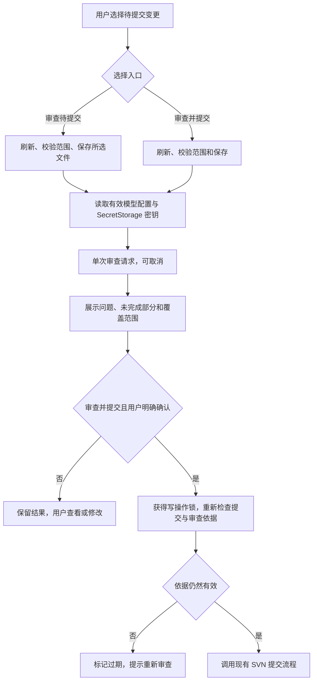

# 插件接入 SVN 提交前审查

状态：已实现首版。本文记录插件接入行为与边界；宿主集成验收仍在进行。

## 目标与用户入口

在当前 SVN 提交选择上完成审查、查看问题和确认提交，复用现有模型设置及 SecretStorage 密钥。用户继续通过「加入待提交」定义范围，审查、提交和 AI 草稿使用同一份提交选择。

建议提供以下入口，不增加全局的强制审查开关：

| 入口 | 位置 | 行为 |
|---|---|---|
| SVN：审查待提交 | SCM 标题栏按钮、命令面板 | 审查当前选择，展示结果 |
| SVN：审查并提交 | SCM 标题栏更多菜单、命令面板 | 审查当前选择，展示结论，由用户确认后提交 |
| SVN：查看审查结果 | 命令面板、结果通知 | 打开当前工作副本的最近一次结果 |
| SVN：提交待提交文件 | 现有位置 | 保留现有直接提交入口 |

`审查并提交` 首版采用「看见结论后确认提交」：无问题时仍显示范围、提交信息和确认按钮；有问题或审查不完整时需要单独确认继续。这样用户能看到模型实际结论和覆盖范围。若希望无问题时直接提交，应作为产品行为调整明确确认，不隐藏在底层实现中。

多个工作副本沿用现有选择器；从某个 SCM 标题栏触发时只处理该工作副本，不弹出跨工作副本选择。

## 典型流程



提交信息是可选审查意图；为空时仍可执行审查。用户确认提交时若输入框为空，再提示填写提交信息。审查只依据当前请求中提供的文本变更，不请求额外 BASE 上下文；用户后来填写的提交信息不改变本次代码审查依据。

仅审查完成后可在结果视图选择「提交此审查选择」，其校验和确认规则与审查并提交一致，不自动复用其他工作副本或不同选择的结果。

## 结果与提交规则

| 审查状态 | 展示 | 审查并提交的后续操作 |
|---|---|---|
| clean | 「已提供范围内未发现符合要求的问题」，展示范围及模型 | 用户选择「确认提交」后继续 |
| findings | 展示所有问题及严重性 | 默认查看或返回修改；选择「仍然提交（有审查问题）」才继续 |
| incomplete | 展示已有问题和不完整状态 | 选择「仍然提交（审查未完成）」才继续 |
| stale | 明确指出审查依据已变化或无法确认 | 当前审查流程停止，需重新审查 |
| error | 配置、服务、超限或输入错误及处理方式 | 当前审查流程停止，支持手动重试 |
| cancelled | 用户取消的运行状态，不作为模型审查结论 | 停止当前流程，保留提交选择和提交信息 |

不完整结果可能同时包含问题，确认时必须同时说明两者。二进制清单不在报告中单独展示。high/medium/low 均展示原始严重性，首版不把模型判断设置为不可绕过的提交禁令；继续提交的确认只对该次结果和选择有效。error/stale 不能在「审查并提交」中当作有效审查继续。

结果不自动修改代码，不改写提交信息。AI 草稿仍通过现有生成入口产生；过期草稿的确认规则独立保留。修改草稿文本后重新审查，防止审查意图与最终提交信息错配。

## 插件配置与数据来源

- 模型设置直接使用 `aiSettings()` 的有效配置，不在插件里再次解析 `settings.json`。
- 密钥直接使用 `context.secrets.get(apiKeySecret)`，不要求插件用户配置 CLI 环境变量。
- SVN 仍在工作区扩展所在环境调用，沿用当前认证和证书配置。
- 提示词从扩展安装目录下 `tools/review_prompt.md` 加载，例如通过 `context.extensionUri` 定位；不从被审查项目中寻找同名文件。
- 使用当前 `view.selected.explicitTargets`、`targets` 和依赖标记，传入精确选择；不调用 CLI 的目录展开入口，也不启动 CLI 子进程。
- 项目说明、依赖版本或检查结果没有输入时继续明确为未知或未执行，不将一次插件审查描述成编译或测试成功。

提示词仍由 CLI 与插件共用。打包时必须包含 `dist/review.js`、新增的运行模块和 `tools/review_prompt.md`；现有 `.vscodeignore` 未排除 `tools`，但仍要核对实际 VSIX 文件清单。

## 必须补齐的共享核心能力

当前 `src/review.ts` 提供差异收集、单次模型请求、结构校验和请求前后检查。审查只使用选择中的变更及文本，不再请求未选择文件的 BASE 上下文。

### 同一工作副本的多个管理目录

当前 `ReviewSelection.scope` 是单目录，插件的管理范围则是同一工作副本中打开目录的并集，不能直接用工作副本根替代。

计划将核心的管理范围扩展为 `scopes: string[]`：

1. 从当前工作副本关联的打开目录构建范围，去重并移除已被打开父目录覆盖的子目录。
2. 分别在这些目录查询 SVN 状态，按规范化路径合并，保留现有嵌套工作副本和 externals 排除规则。
3. 所选项、目录删除的有效子项和必需依赖都必须落在至少一个打开目录中；审查不读取管理范围内未选择文件。
4. 各路径的读取使用包含它的管理目录，不用目录的共同祖先扩大范围。
5. 同一工作副本的管理目录出现不同 SVN 可执行配置时，在发送请求前提示统一配置；首版不在一次审查里混用多个客户端。模型配置遵循当前单套有效配置约定。

例：打开 `/wc/a` 和 `/wc/c`，可一次审查两处选择；模型请求 `/wc/b/helper.ts` 时仍拒绝，不能把 `/wc` 当作管理范围。CLI 用单元素 `scopes` 适配，原有参数保持兼容。

### 可在提交前重验的审查会话

当前 `unchanged()` 是 `reviewSelection()` 内部闭包，返回后无法重验，`ReviewResult` 也没有问题定位所需的完整文本快照。因此仅缓存返回的 JSON 不足以支持审查并提交。

建议将已有快照和检查逻辑收敛为一个 Module，提供如下最小 Interface（名称为设计示意，不代表已实现）：

```ts
interface ReviewSession {
  readonly result: ReviewResult;
  isCurrent(selection: ReviewSelection): Promise<boolean>;
  snapshot(finding: ReviewFinding): ReviewLocation;
}

interface ReviewLocation {
  file: string;
  side: 'old' | 'new';
  text: string;
  lineStart: number;
  lineEnd: number;
}

runReview(input: ReviewInput, signal?: AbortSignal): Promise<ReviewSession>;
```

`ReviewInput` 聚合选择、有效模型配置、密钥、提示词和可选修改意图。会话保存审查使用的文本、属性和复制来源，封装内容重读和比较；`isCurrent` 同时比较精确选择、依赖和管理范围。snapshot 返回已有文本，不重新读取当前磁盘版本。

现有 CLI `reviewSelection()` 可保留为薄 Adapter，返回 `(await runReview(...)).result`，避免把宿主会话数据序列化到 CLI JSON 中。凭据和快照只保存在本窗口内存中，不记录密钥，不随结果持久化。

插件 Adapter 负责核心无法感知的条件：未保存编辑器缓冲区、视图是否仍存在、选择变化的运行代号、已提供修改意图的变化和运行取消。核心不 import `vscode`。

## 结果视图与定位

建议在 SCM 下增加原生「SVN 审查结果」TreeView，按工作副本展示最近一次结果。

```text
SVN 审查结果
  项目 A：发现 2 个问题
    [high] 重复执行写操作  src/order.ts:42
    [medium] 空结果访问  src/query.ts:18
    覆盖范围：5 项选择
    重新审查 / 提交此审查选择
  项目 B：审查不完整
    审查不完整；查看已有问题
```

- 点击问题打开审查时该侧的只读代码快照，并定位行范围；完整触发条件、证据、后果、建议及验证用例在只读结果文档中查看。
- 使用单独的 `codeSvnReview` 内容方案，以审查会话和受控路径定位快照；不把 old 行直接定位到当前工作文件。
- old 可以是删除文件的 BASE 或复制来源修订；new 是审查时选定的工作副本文本。使用会话实际文本，保证与模型收到的行号一致。
- 如需修改，可从有效结果另行打开工作文件。已过期结果保留用于阅读，但显著标记，不能作为提交依据。
- 只保留每个工作副本的最近一份结果；重审时旧结果标为已替换。刷新视图不触发模型请求，重启插件后不恢复审查授权。

## 生命周期与并发

每个工作副本最多一个活动审查。运行记录保存控制器、唯一运行代号、开始时的视图、选择、管理范围、提交信息和配置身份；每个结果另有不可复用的结果身份。

建议沿用现有 `WorkingCopyWrites` 的工作副本操作锁：审查收集和网络请求期间持有锁，阻止插件在同一工作副本执行添加、撤销、更新或提交；用户仍可浏览、编辑和调整选择。代价是模型等待期间需要先取消审查才能执行这些 SVN 操作，进度通知必须提供取消。

结果返回后释放锁，再展示确认或供用户修改；不能一直持锁等待用户阅读。确认提交时重新获得锁并检查所有依据，不能假设释放锁后数据仍相同。同一工作副本的草稿生成与审查互相提示等待或取消，避免并行修改审查意图；不同工作副本可以并行。

对以下事件做处理：

| 事件 | 行为 |
|---|---|
| 重复点击审查 | 提示已有运行，提供取消入口，不重复请求 |
| 运行中选择或已提供的修改意图变化 | 使该运行失效，取消请求；旧回调不能进入提交分支 |
| 选定有效文本出现未保存修改 | 使结果失效；开始审查前提供保存并审查或取消 |
| 未选择文件内容变化 | 不影响审查依据；未选择文件不会作为补充上下文读取 |
| 管理目录、模型配置或提示词变化 | 标记相关结果过期，后续重审使用新配置 |
| BASE、复制来源或属性变化 | 重验不一致时标记过期 |
| 工作副本移出窗口、扩展停用 | 取消运行并释放资源，旧回调不得复活已移除的视图 |
| 用户取消 | 不触发提交；已启动的 SVN 只读查询遵循现有限时 |

后台文件事件可以提示过期，但不能作为唯一依据；文件系统事件可能遗漏，提交前仍须主动重验。编辑范围按实际选定输入和有效删除子项确定，不能把一次目录属性选择扩张成该目录全部未保存文件。

## 与现有提交函数的接缝

当前 `commit()` 已包含工作副本选择、写操作锁、刷新、提交选择校验、保存、草稿检查和真实提交。建议只提取必要的内部步骤，使普通提交和审查并提交共用实际提交路径，不复制 `commitFiles()` 的后处理。

在审查并提交分支中，最终顺序应为：

1. 用户针对本次结果确认；findings/incomplete 记录对应的明确继续选择。
2. 取得该工作副本操作锁，检查本次结果仍是当前会话且未被使用。
3. 刷新，检查视图身份、当前 scopes、精确选择及依赖，调用插件现有 `selected.validate()`。
4. 检查有效选定文件没有未保存修改；若审查时提供了修改意图，确认其仍一致。若提交信息为空，在最终提交前提示填写。
5. 处理现有过期草稿确认。任何需要用户等待的弹窗结束后，继续重验审查依据。
6. 调用 `session.isCurrent(currentSelection)`，并复核当前运行代号和编辑器状态；若不符，标记过期并结束。
7. 消费该次结果的提交确认，使用同一组 targets 和最终提交信息调用 `commitFiles()`。
8. 沿用现有成功刷新、清理选择、清理草稿和提示修订号的行为，同时将对应审查结果标为已使用。

不能只在运行审查之前校验一次，也不能只比文件路径或结果的 `status === 'clean'`。不得在某个延迟通知回调中直接调用裸提交。

这不能提供跨编辑器、外部 SVN 进程和文件系统的原子事务，也不能检测内容在两次读取间改变又恢复；方案承诺插件操作互斥、输入前后比较和最后一次重验。SVN 提交报错或结果不确定时不自动重试；保留选择和输入，并要求核对实际仓库状态后重新操作，不把旧确认当作再次提交的授权。

## 修改范围与实施顺序

| 步骤 | 主要文件 | 完成标准 |
|---|---|---|
| 1. 扩展核心会话及多目录范围 | `src/review.ts`，必要的 SVN 读取辅助函数 | CLI 既有 JSON/退出码兼容；多个打开目录正确合并、范围外上下文仍拒绝；返回后可以重验和定位 |
| 2. 增加宿主审查编排 | `src/extension.ts`、`package.json` | 注册审查入口，读取有效配置/SecretStorage，传入精确选择，支持保存、取消和工作副本隔离 |
| 3. 展示原生审查结果 | 新增 `src/review-ui.ts` | 问题、未完成部分、覆盖范围与过期状态可见，old/new 快照行定位正确 |
| 4. 接入审查并提交 | `src/extension.ts` 中提交编排 | 所有提交路径共用原有提交执行；最终确认后主动重验，重复操作不产生重复提交 |
| 5. 文档、打包和宿主验收 | README、测试、VSIX 清单 | 安装产物包含提示词和核心；源码宿主及安装包中的行为一致 |

首版不增加自动修复、远程服务、后台自动审查、多套模型策略或额外的报告数据库。

## 验收场景

核心定向测试沿用真实本地 SVN 和可控模型服务；插件集成通过实际命令和 SCM 入口驱动。新增会话逻辑的测试也通过共享 Interface 验证，不依赖读取内部 Map。

1. 单个工作副本的精确选择及依赖进入模型；插件不使用 CLI 的目录递归规则。
2. 同一工作副本同时打开 `/wc/a` 和 `/wc/c`，两处均可审查，`/wc/b` 不能成为上下文；另一个工作副本完全隔离。
3. 已有 AI 设置和 SecretStorage 密钥直接可用；缺配置、取消保存、输入超限时没有模型请求或 SVN 提交。
4. clean、findings、incomplete 的结果和确认按钮符合表中规则；有问题且不完整时不会漏掉问题；取消确认不提交。
5. 请求进行中更换选择、编辑未保存内容或改变提交信息，旧响应不能进入提交分支。
6. 结果出来后修改文本、属性、目录范围或依赖，确认提交必须停止，即使监听事件未到达。
7. 删除文件 old 行、复制来源 old 行及工作副本 new 行均打开正确快照。
8. 重复点击、在结果确认期间启动另一份审查、普通提交成功及工作副本移除，不造成重复提交或旧结果复用。
9. 配置错误、服务超时、非法响应和用户取消保留选择及提交信息，释放操作锁。
10. 现有普通提交、生成草稿、草稿过期、更新、撤销、复制/移动和目录操作的回归仍通过。
11. 核对 VSIX 内的提示词和运行文件；分别记录 Windows、VS Code WSL 与真实模型兼容性，不将本地假服务结果视为完整宿主验收。

关联：[现有 CLI 设计](../tools/review-cli-design.md)、[ADR 0001](adr/0001-ai-commit-boundary.md)、[ADR 0003](adr/0003-opened-directory-boundary.md)、[ADR 0004](adr/0004-precommit-review-context.md)。
